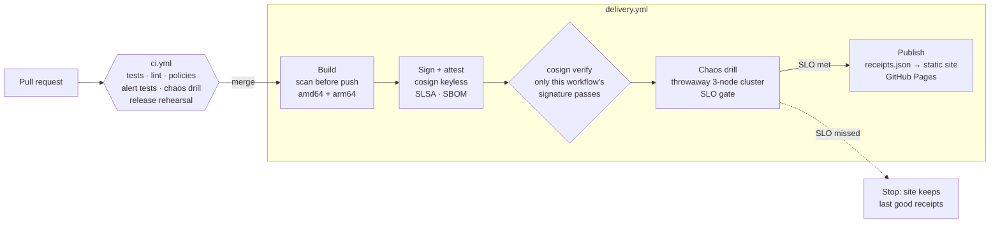
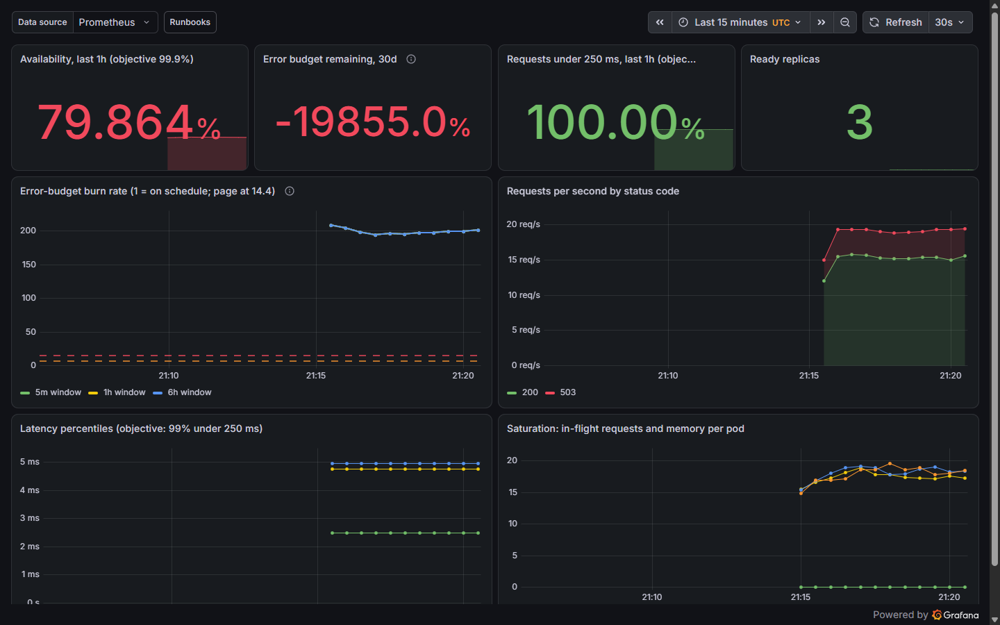

# resume-as-code

**A resume served by the production platform it describes.**

[](https://github.com/ElliottSax/resume-as-code/actions/workflows/delivery.yml)
[](https://scorecard.dev/viewer/?uri=github.com/ElliottSax/resume-as-code)
[](LICENSE)

### → [Read the resume](https://elliottsax.github.io/resume-as-code/)

I'm Elliott Saxton. I've spent fifteen years in operations: aircraft turns for Delta, distribution centers at SuperValu and Best Buy, and payment operations at Target. I'm moving into DevOps and SRE. Rather than list tools I've touched, I built one small service and run it the way production systems should be run. **Every claim on the resume is checked by the pipeline that publishes it**, and the page shows the receipts.

## In sixty seconds

- **The service:** about 1,100 lines of Go, with Prometheus metrics, structured logs and graceful shutdown. It ships as a distroless, non-root, read-only image of a few MB, built for amd64 and arm64.
- **Every release:** test → build → scan → push → sign (keyless) → attest (SLSA provenance, SBOM) → verify the signature → **chaos drill** → publish.
- **The chaos drill:** builds a three-node Kubernetes cluster from nothing, deploys with Helm, then sends 18,000 requests while killing pods, rolling out a deploy and draining a node. The release is blocked unless 99.9% succeed and 99% finish in under 250 ms. *Last run: 0 failed, p99 2.2 ms.*
- **Operations:** SLOs with multi-window burn-rate alerts (unit-tested), a runbook for every alert, and [postmortems of real incidents](docs/postmortems/).
- **Guardrails:** 7 Kyverno policies tested against good and bad manifests, Pod Security "restricted" at admission and default-deny NetworkPolicy. The drill checks that the last two actually block.
- **Infrastructure as code:** Terraform for this repository's own settings, plus a Cloud Run production target that deploys with OIDC and stores no keys.
- **Cost:** $0 a month.

## How this page proves itself



The "receipts" panel at the top of the resume is rendered from [`receipts.json`](https://elliottsax.github.io/resume-as-code/receipts.json), which [`scripts/receipts.sh`](scripts/receipts.sh) assembles from raw tool output. None of it is typed by hand.

| Receipt | Measured by | Check it yourself |
|---|---|---|
| Commit and pipeline run | GitHub Actions | the link on the page goes to the run |
| Image size, signature, SBOM | registry manifest, cosign, Trivy | `cosign verify …` (command on the page) |
| Vulnerabilities | Trivy, with a fresh database every week | download the SBOM; scan it yourself |
| Tests and coverage | `go test -race -json` | `make test` |
| Drill results | k6 inside the cluster, from the client's side | `make drill` |
| Guardrails | the drill tries a privileged pod and a cross-namespace request | `make drill` |

The pipeline runs every Monday as well, so the receipts stay fresh, and a CVE newly published against a pinned base image fails the build without anyone having to look.

## The chaos drill

[`scripts/drill.sh`](scripts/drill.sh) runs on every pull request and every release. Each fault stands in for something that happens in production:

| When (share of the 3-minute run) | Fault | The real-world event it simulates |
|---|---|---|
| 10%, 20% | kill a random pod | crash, OOM kill, hardware failure |
| 30% | rolling restart | every deploy |
| 50% | drain a worker node | kernel patching, cluster upgrades, spot reclaims |
| 75%, 85% | kill a random pod | the next failure, on top of the last |

The load generator runs on the control-plane node, so draining a worker never takes out the thing measuring the damage. It sends a constant **arrival rate**: if the service slows down, requests keep coming, as real traffic does.

**Why it can pass with zero errors.** A deleted pod is removed from the Service and sent SIGTERM *at the same time*, and every node's routing rules take a moment to catch up. Without care, that gap drops requests. This is the sequence that closes it:

```mermaid
sequenceDiagram
    participant K as Kubernetes
    participant P as Pod
    participant N as Every node's routing (kube-proxy)
    K->>N: remove pod from Service endpoints
    K->>P: run preStop hook (sleep 5s)
    Note over P: still serving: requests already<br/>routed here still succeed
    N-->>N: routing updated; no new traffic to the pod
    K->>P: SIGTERM
    P->>P: readiness → 503, stop accepting connections
    P->>P: finish in-flight requests, exit 0
```

The rest of the setup does its part too. `maxUnavailable: 0` in rollouts means a new pod is ready before an old one goes. The PodDisruptionBudget lets a node drain evict only one replica at a time. Topology spread keeps the replicas on different nodes.

## Run it yourself

You need Linux, macOS or WSL2, with Docker, `make`, `curl` and `jq`.

```sh
git clone https://github.com/ElliottSax/resume-as-code && cd resume-as-code
make tools        # exact, checksum-verified versions of kind, Helm, Trivy, Terraform...
make check        # every static check CI runs
make drill        # the full chaos drill (about 6 minutes)
make release-dry-run   # rehearse the release on a throwaway registry, minus signing

make up           # leave a cluster running (prints the port-forward to open the site)
make observe      # add Prometheus, Grafana and the SLO dashboard
scripts/observe.sh --break   # fail 20% of requests; watch the burn-rate alert fire
scripts/observe.sh --fix
make down
```

This is what `scripts/observe.sh --break` looks like on a local cluster. With 20% of requests failing, the burn rate sits around 200×, far over the paging line at 14.4. `ResumeErrorBudgetBurnFast` went from pending to firing after three minutes, carrying a link to its runbook:



## What's where

```
app/                     the Go service (main.go, internal/server, internal/site, internal/resume)
  content/resume.yaml    the resume itself: schema-validated, unknown keys rejected
Dockerfile               two-stage build onto distroless, base images pinned by digest
deploy/helm/resume/      the chart: hardened Deployment, HPA, PDB, NetworkPolicy, ServiceMonitor,
                         PrometheusRule, Grafana dashboard, HTTPRoute, helm test
  files/slo-rules.yaml   SLO recording rules and burn-rate alerts
deploy/kind/             the drill's three-node cluster
loadtest/k6.js           the drill's traffic: constant arrival rate, SLO thresholds
observability/tests/     promtool unit tests for every alert
policy/                  Kyverno policies and their tests
infra/terraform/         github/ (this repo's settings) and gcp-cloud-run/ (production target)
scripts/                 install-tools, drill, observe, receipts, image-facts, release-dry-run
.github/workflows/       ci (PRs), delivery (main + weekly), scorecard
docs/                    SLOs, supply chain, runbooks, postmortems, ADRs
tools.env                every tool and image version, in one place
```

## Bugs the guardrails caught while building this

Every one of these passed the static checks, and only a check that exercised the real thing caught it:

1. **Kyverno silently skipped five of seven policies.** YAML anchors don't cross `---` document boundaries, and the broken documents were dropped without an error. `kyverno test`, which requires every policy to fail a known-bad manifest, caught it. ([ADR 0004](docs/adr/0004-policy-in-ci-and-at-admission.md))
2. **The `helm test` pod inherited the app's selector labels**, a pattern straight from the `helm create` scaffold. The NetworkPolicy's deny-all egress then cut off the test itself, the Service routed real traffic to it, and the PodDisruptionBudget counted it as a replica. The drill's first full run caught it.
3. **Helm 4's `--wait` was satisfied by one replica.** With an autoscaler in charge, the chart rightly sets no replica count, so a fresh install starts at one. The drill now waits for the HPA's minimum before it calls the service deployed.
4. **kind couldn't import multi-arch images** pulled for one platform, because the index names layers that were never downloaded. Fixed by exporting only the host's platform.
5. **awk printed epoch timestamps as `1.79539e+09`**, which scheduled every chaos event in the past. The drill fired all its faults in the first second, and reported a timeout. Fixed with explicit `printf`.
6. **The arm64 build ran an arm64 binary on an amd64 machine.** The Dockerfile cross-compiles for the target CPU, then ran the result to validate the resume. That only works with an emulator installed, and the release job installs none. A [release rehearsal](scripts/release-dry-run.sh) against a throwaway registry caught it before the first push, and now runs on every pull request.
7. **A jq precedence slip would have failed the release after merge.** In the script that reads the image size back from the registry, `[.layers[].size] | add + .config.size` means `… | (add + .config.size)`, which looks up `.config` on a list of numbers. ShellCheck can't see inside a jq program. The same rehearsal caught it.

## Operations

- [Service level objectives](docs/slo.md): what is promised, why those numbers, how alerts work, the error budget policy
- [Runbooks](docs/runbooks/): one per alert, each linked from the alert itself
- [Postmortems](docs/postmortems/): three real incidents from systems I run, and what each changed here
- [Supply chain](docs/supply-chain.md): what is pinned, what is signed, how to verify it without trusting me
- [Architecture decisions](docs/adr/): Go and distroless, throwaway clusters, no CPU limits, policy placement, Cloud Run, pinning, Gateway API

## What I'd do next

- **GitOps with Argo CD:** pull-based deploys and drift detection for a long-lived cluster.
- **Canary releases** on Cloud Run, with automatic rollback when the burn rate spikes.
- **Signature verification at admission** (Sigstore policy-controller), so the cluster itself refuses unsigned images.
- **OpenTelemetry tracing**, once there's more than one service to trace across.

## License

[MIT](LICENSE). The resume content in `app/content/resume.yaml` is mine; please don't reuse it as yours.
