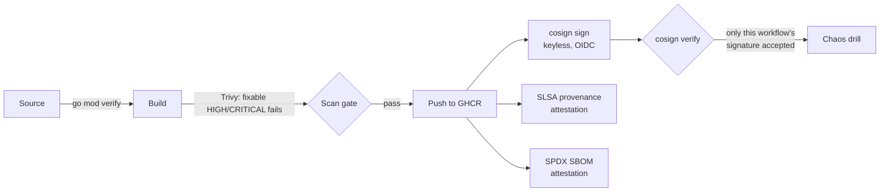

# Software supply chain

In a warehouse, you reconcile the manifest against what's actually on the trailer. Here, the same job means knowing exactly what is inside every image, who built it, and from what source, and being able to prove all three to someone who doesn't trust you.

## What is pinned

Nothing in the build floats. Every input is fixed to exact bytes, and Dependabot proposes each update as a PR that has to pass the full pipeline:

| Input | Pinned by | Where |
|---|---|---|
| GitHub Actions | full commit SHA (a tag can be moved to malicious code; a SHA can't) | `.github/workflows/*.yml` |
| Base images | `sha256` digest | [`Dockerfile`](../Dockerfile) |
| CLI tools (kind, Helm, Trivy, Terraform…) | exact version + checksum verified on download | [`tools.env`](../tools.env), [`install-tools.sh`](../scripts/install-tools.sh) |
| Go modules | `go.sum` hashes, checked with `go mod verify` during the build | [`app/go.sum`](../app/go.sum) |
| Drill images (kind node, k6) | `sha256` digest | [`tools.env`](../tools.env) |
| Terraform providers | lock file with hashes | `infra/terraform/*/.terraform.lock.hcl` |

CI installs tools with the same script a laptop uses, not with third-party `setup-*` actions. That leaves fewer people who can push code into the pipeline.

## What is checked, and when



- **Scan before push.** The image is built and scanned locally first. A vulnerable image never reaches the registry. Both architectures are scanned.
- **Keyless signing.** No signing key exists to leak. GitHub issues the workflow a short-lived OIDC token, Sigstore's Fulcio turns it into a certificate that names this exact workflow, and the signature goes into the public Rekor transparency log.
- **Verify before deploy.** The drill job runs `cosign verify` against the exact identity `…/.github/workflows/delivery.yml@refs/heads/main` and refuses to deploy anything else, including an image pushed by hand with stolen credentials. In a cluster, an admission controller (Kyverno or Sigstore's policy-controller) would do the same check.
- **Provenance.** The SLSA build provenance records which workflow, commit and runner produced the image.
- **SBOM.** An SPDX bill of materials for every image, attested to the image and published on the site.

## Verify it yourself

You need nothing from me, no key and no account, to check any of this:

```sh
IMAGE=ghcr.io/elliottsax/resume-as-code
DIGEST=$(curl -s https://elliottsax.github.io/resume-as-code/receipts.json | jq -r .image.digest)

# Signed by this repository's delivery workflow, on main?
cosign verify "$IMAGE@$DIGEST" \
  --certificate-oidc-issuer https://token.actions.githubusercontent.com \
  --certificate-identity "https://github.com/ElliottSax/resume-as-code/.github/workflows/delivery.yml@refs/heads/main"

# Built from this repository's source, by GitHub Actions?
gh attestation verify "oci://$IMAGE@$DIGEST" --repo ElliottSax/resume-as-code

# What's inside?
curl -s https://elliottsax.github.io/resume-as-code/sbom.spdx.json | jq -r '.packages[].name' | sort -u
```

## Independent check

[OpenSSF Scorecard](https://scorecard.dev/viewer/?uri=github.com/ElliottSax/resume-as-code) audits the repository weekly: pinned dependencies, token permissions, branch protection, signed artifacts and more. The badge in the README links to the live result.
